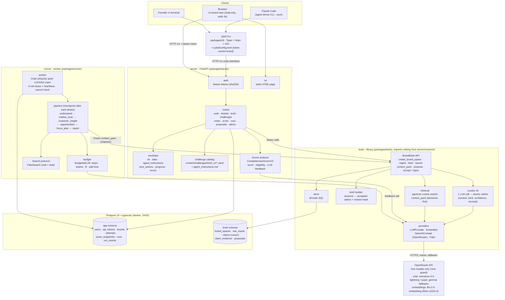
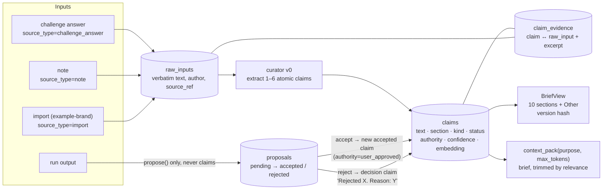
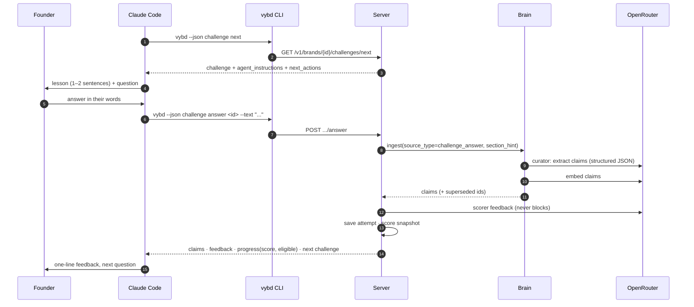
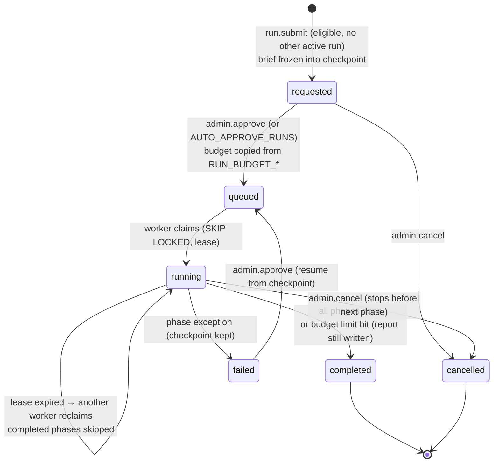
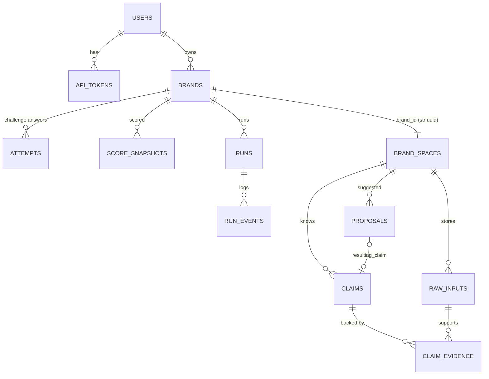

# Vybd Brand Builder: architecture (as built, 2026-11-01)

A founder completes a guided ~10-minute brand brief through the `vybd` CLI, driven by Claude Code or typed by hand. They then submit it for a budgeted, checkpointed background **Brand Brain run**, which returns a report plus proposed brief changes. The founder accepts or rejects each proposal.

There are four packages in one uv workspace. Postgres has two schemas, and models are reached through OpenRouter (free models only, behind an OpenAI-compatible adapter).

## System overview

**Layering rules** (enforced by import-linter in `make lint`):
- `brain` never imports `server`, `runner` or `vybd_cli`.
- `vybd_cli` never imports `brain`, `server` or `runner`; it talks HTTP only.
- `runner` may use `brain` and `server`'s models (the `runs` table).

## The Brand Brain (knowledge model)

- **Claim kinds:** fact, decision, constraint, hypothesis, idea, preference.
- **Statuses:** accepted, proposed, rejected, superseded, parked.
- **Re-answering a challenge** supersedes only the claims from that challenge's earlier answers. Notes in the same section survive.
- **Brief sections:** `one_liner, customer, problem, alternative, positioning, product, price, channels, competitors, goals`. Unknown sections show under "Other".

## Answer flow

If the LLM fails during ingest, the server returns `502 provider_unavailable` with a retry instruction and records no attempt.

## Run lifecycle

`paused` and `approved` exist in the schema but nothing uses them yet.

## Data model

The left side is the `app` schema (owned by the server); the right side is the `brain` schema (owned by the brain library). They are joined only by `brand_id`.

## Configuration

| Setting | Current local value | Notes |
|---|---|---|
| `LLM_PROVIDER` / `EMBED_PROVIDER` | `openai_compat` | `fake` for tests and CI |
| `LLM_MODEL` / `LLM_MODELS` | nemotron-3.5-lightning, then fallbacks | interactive calls (curator, feedback) |
| `RUNNER_LLM_MODEL` / `RUNNER_LLM_MODELS` | nemotron-3.5-super, then fallbacks | background run phases |
| `LLM_MIN_MAX_TOKENS` / `LLM_REASONING_EFFORT` | 4000 / low | protection against reasoning models returning empty output |
| `ALLOW_PAID_MODELS` | false | refuses any non-`:free` OpenRouter model |
| `EMBED_MODEL` / `EMBED_DIM` | lfm-2.5-embedding-350m / 1024 | dimension is fixed when the brain migration runs |
| `SEARCH_PROVIDER` | fake | the real provider is a stub |
| `AUTO_APPROVE_RUNS` | true (dev only) | false in normal use; admins approve |
| `RUN_BUDGET_*` | 10h · 2M tokens · $25 · 400 steps | placeholders |

## Where things live

| Path | What |
|---|---|
| `packages/brain/src/brain/` | `api.py` (BrandBrain), `curator.py`, `store.py`, `brief.py`, `retrieval.py`, `providers/` |
| `packages/server/src/server/` | `main.py`, `routes/`, `envelope.py`, `challenges.py`, `scoring/`, `ui/index.html` |
| `packages/runner/src/runner/` | `worker.py`, `budget.py`, `pipeline.py`, `phases/`, `search.py` |
| `packages/cli/src/vybd_cli/` | `main.py`, `client.py`, `config.py`, `render.py` |
| `content/` | challenge YAMLs and the global agent instructions |
| `evals/personas/` | 4 founder personas for end-to-end tests |
| `scripts/` | `e2e_fake.py`, `curl_brief.sh`, `import_example-brand.py` |
| `docs/` | DECISIONS, IDEAS, PROVIDER_NOTES, example-brand_MIGRATION, BACKLOG |

See [BACKLOG.md](BACKLOG.md) for what's next.
