# Vybd Brand Builder: backlog and roadmap (2026-11-01)

This is the same system as [ARCHITECTURE.md](ARCHITECTURE.md), with every component colour-coded by status.

- 🟩 **Done:** built and tested (fake providers in CI; real OpenRouter verified for chat, extraction and embeddings).
- 🟨 **Partial / stub:** exists behind the right interface, but crude or placeholder (`# STUB:` in code).
- ⬜ **Backlog:** not built. The seam exists, or the item is planned.
- 🟥 **Known issue:** works, but needs fixing before real founders use it.

## Status map

```mermaid
flowchart TB
    classDef done fill:#dcfce7,stroke:#15803d,color:#14532d
    classDef partial fill:#fef9c3,stroke:#a16207,color:#713f12
    classDef backlog fill:#f3f4f6,stroke:#9ca3af,color:#4b5563,stroke-dasharray:5 4
    classDef issue fill:#fee2e2,stroke:#b91c1c,color:#7f1d1d

    %% ---------- clients ----------
    subgraph Clients["Clients"]
        CC["Claude Code driving CLI"]:::done
        Human["Founder in terminal"]:::done
        UIv["/ui read-only brand view"]:::done
        WebChat["Web chat UI<br/>own orchestrator agent"]:::backlog
        MCP["MCP server<br/>next_actions → tools, OAuth 2.1"]:::backlog
    end

    CLI["vybd CLI<br/>all §9 commands, --json, vybd ui"]:::done
    Publish["Publish CLI<br/>uv tool install vybd-cli"]:::backlog
    CC --> CLI
    Human --> CLI
    Publish -.-> CLI

    %% ---------- server ----------
    subgraph Server["server"]
        Auth["Token auth + signup"]:::done
        Login["Login / token recovery<br/>email verification"]:::backlog
        Routes["API routes + envelope"]:::done
        Chal["9 brief_v1 challenges"]:::done
        Tiers["Challenge tiers<br/>unlocked by score, evidence challenges"]:::backlog
        Scorer["CompletenessScorerV0"]:::partial
        RealScore["Real scorer<br/>quality, specificity, evidence"]:::backlog
        Latency["Answer latency ~80s<br/>curator + feedback in series"]:::issue
        Admin["Admin approve / cancel"]:::done
        AutoReview["Automated run review / audit"]:::backlog
        Collab["Brand members + roles"]:::backlog
        Pay["Payments / run credits"]:::backlog
    end

    MCP -.-> Routes
    WebChat -.-> Routes
    CLI --> Auth --> Routes
    UIv --> Routes
    Routes --> Chal
    Routes --> Scorer
    Scorer -.-> RealScore
    Chal -.-> Tiers
    Auth -.-> Login
    Admin -.-> AutoReview

    %% ---------- brain ----------
    subgraph Brain["brain"]
        BB["BrandBrain API"]:::done
        Curator["Curator v0<br/>extract + add"]:::partial
        CuratorV1["Curator v1<br/>dedup · merge · supersede<br/>parking lot · review queue"]:::backlog
        Retr["pgvector search + context_pack"]:::done
        TokenEst["Real token counting<br/>section summaries when trimming"]:::backlog
        Props["Proposals accept / reject"]:::done
        Outputs["Output store<br/>record_output / recent_outputs"]:::backlog
        Reembed["make reembed<br/>embedding model migration"]:::backlog
        Prov["OpenAI-compat provider<br/>OpenRouter :free guard, fallbacks"]:::done
        Routing["Per-phase / per-task model routing"]:::partial
        Vendor["Native Vertex / Anthropic adapters"]:::backlog
        Img["Image provider<br/>ported, unused"]:::partial
    end

    Routes --> BB
    BB --> Curator -.-> CuratorV1
    BB --> Retr -.-> TokenEst
    BB --> Props
    BB -.-> Outputs
    Retr -.-> Reembed
    Curator --> Prov
    Prov --> Routing
    Prov -.-> Vendor
    Prov -.-> Img

    %% ---------- runner ----------
    subgraph Runner["runner"]
        Worker["Worker: lease, heartbeat, resume"]:::done
        Budget["Budget metering + clean stop"]:::done
        Phases["6-phase pipeline v0"]:::done
        Search["Search provider"]:::partial
        RealSearch["Real search<br/>free API or web-enabled model"]:::backlog
        Loops["Looping deep-research phases<br/>fill the 10h budget"]:::backlog
        PartialCk["Mid-phase checkpoints"]:::backlog
        Resume["vybd admin resume"]:::backlog
        Cost["Cost / quality tuning"]:::backlog
    end

    Worker --> Phases --> Budget --> Prov
    Phases --> Search -.-> RealSearch
    Phases -.-> Loops
    Worker -.-> PartialCk
    Worker -.-> Resume
    Budget -.-> Cost
    Phases -- "propose()" --> Props

    %% ---------- data ----------
    subgraph Data["Postgres + pgvector"]
        App[("app schema")]:::done
        BrainS[("brain schema")]:::done
    end
    Routes --> App
    Worker --> App
    BB --> BrainS

    %% ---------- ecosystem ----------
    subgraph Eco["Vybd ecosystem consumers"]
        Bay["example-brand imported as tenant"]:::done
        Camp["Campaign builder on new brain<br/>context_pack instead of supermemory"]:::backlog
        IG["IG engagement digests<br/>→ propose(origin=ig_digest)"]:::backlog
        Ops["Ops agents"]:::backlog
    end
    Bay --> BB
    Camp -.-> BB
    IG -.-> Props
    Ops -.-> BB

    %% ---------- quality ----------
    subgraph QA["Testing & evals"]
        Unit["63 unit / integration tests<br/>+ import-linter + CI"]:::done
        E2E["make e2e-fake<br/>scripted clear founder"]:::done
        Personas["4 personas + CLAUDE.md persona run"]:::done
        LivePersona["Real-model persona runs<br/>graded transcripts"]:::partial
        Quality["Report / proposal quality evals"]:::backlog
    end
```

Solid arrows show built connections. Dotted arrows lead to backlog items.

## Prioritised backlog

### Now: before real founders touch it

| # | Item | Status | Why / notes |
|---|---|---|---|
| 1 | **Fix answer latency** (about 80s per answer on free models) | 🟥 | Return as soon as the claims are saved and compute feedback in the background, or show it on the next call. Skip models that do long reasoning for interactive calls. Time the embedding call too. Target: under 15s per answer. |
| 2 | **Real-model persona runs** (all 4 personas) with graded transcripts | 🟨 | The persona run was started (Kanthari) and stopped at the latency issue. Re-run after #1 and record time, places it got stuck, and how clear the instructions were. |
| 3 | **Rotate the OpenRouter key** | 🟥 | Rotate before the repository goes public. |
| 4 | **Free-model reliability** | 🟨 | Gemma, Xing and Liquid were rate-limited upstream, and Inkling only works in approved agent apps. Track which models actually work, auto-skip ones returning 403/429 for a cooldown, and decide whether "free only" holds once real users arrive. |
| 5 | **Real search provider** for `market_scan` | 🟨 | The fake search makes the competitor section of the report weak. |

### Next: product depth

| # | Item | Status | Notes |
|---|---|---|---|
| 6 | Curator v1: dedup, merge, supersede against existing claims | ⬜ | Needed for ramblers and repeat notes (Brand Brain v2 design doc) |
| 7 | Real scorer (quality, specificity, evidence) | ⬜ | Slots into the `Scorer` protocol; `scorer_version` keeps history valid |
| 8 | Looping research phases that use the remaining budget | ⬜ | Fits behind `Phase` + `budget` |
| 9 | Mid-phase checkpoints, plus a dedicated `vybd admin resume` | ⬜ | Today a budget stop loses the interrupted phase's work, and resume is done through `approve` |
| 10 | Better `context_pack`: real token counts, summaries of trimmed sections | ⬜ | |
| 11 | Login and token recovery, email verification | ⬜ | v0 allows one signup per email and the token is shown once |
| 12 | Publish the CLI (`uv tool install vybd-cli`) and host the server | ⬜ | |

### Later: platform

| # | Item | Status | Notes |
|---|---|---|---|
| 13 | MCP server (`packages/mcp`), OAuth 2.1 | ⬜ | `next_actions` names map 1:1 to tools |
| 14 | Web chat UI with an orchestrator agent | ⬜ | Reads the same envelope |
| 15 | Automated run review / audit (replacing manual approval) | ⬜ | The approval step is the hook |
| 16 | Challenge tiers unlocked by score; real-world evidence challenges | ⬜ | `content/challenges/<tier>/` |
| 17 | Collaboration: brand members and roles | ⬜ | The brain is already brand-scoped |
| 18 | Payments / run credits | ⬜ | |
| 19 | Cost and quality tuning, per-phase model routing | 🟨 | Interactive and runner models are already split (`RUNNER_LLM_MODEL`) |
| 20 | Native Vertex / Anthropic adapters (optional) | ⬜ | Only if a vendor-specific feature becomes necessary |

### Ecosystem: one brain, many consumers

| # | Item | Status | Notes |
|---|---|---|---|
| 21 | example-brand imported as a tenant | 🟩 | `make seed`; real-model import not yet run |
| 22 | Output store (`record_output` / `recent_outputs`) | ⬜ | Blocks the campaign-builder migration (anti-repetition) |
| 23 | Campaign builder on the new brain (`context_pack`) | ⬜ | See example-brand_MIGRATION.md |
| 24 | IG performance digests as proposals | ⬜ | The founder approves what the brand "learns" |
| 25 | `make reembed` for embedding model changes | ⬜ | `claims.embed_model` is already stored |

## Done so far (milestones)

| Milestone | Status |
|---|---|
| M1 Repo skeleton: uv workspace, compose, Alembic ×2, CI, import-linter | 🟩 |
| M2 Brain v0 + OpenRouter adapter (live-verified) | 🟩 |
| M3 Server core: auth, brands, envelope, 9 challenges, answer flow, notes, brief | 🟩 |
| M4 CLI: every §9 command, `--json`, config | 🟩 |
| M5 Scoring v0, eligibility, submit, admin approve/cancel, proposals API | 🟩 |
| M6 Runner: lease, budget, checkpoints, resume, 6 phases, report, proposals | 🟩 |
| M7 Personas, CLAUDE.md persona run, `make e2e-fake` | 🟩 |
| M8 example-brand as tenant, migration doc | 🟩 |
| Extra: `/ui` brand view, `vybd ui`, brand runs list, per-role models, reasoning-model protection | 🟩 |

Out-of-scope ideas that come up go to [IDEAS.md](IDEAS.md). Decisions go to [DECISIONS.md](DECISIONS.md).
